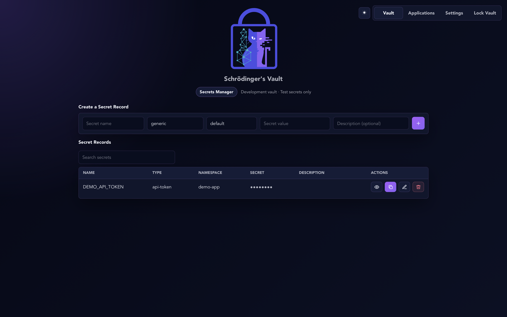

# Schrödinger’s Vault

## A secret manager that runs on your own Mac

Schrödinger’s Vault stores application secrets, such as API keys and database credentials, in an encrypted local vault. You unlock the vault with a master password and decide which connected applications may read which secrets.

You do not need a cloud vault account. The vault and a connected application run on the same computer. An application may still need the internet to use a service such as a weather provider.

> **Research prototype: use test secrets first.** The current secret-manager workflow has been evaluated on macOS. It has not completed an independent security audit. Windows and Linux support are not yet validated. There is no password-reset recovery: losing the master password or device key material can make your records inaccessible.



## Start here

- [Download the source ZIP](https://github.com/EvolvingCyberOpenSource/SchrodingerVault-SecretManager/archive/refs/heads/main.zip). This contains source files, not a double-click installer.
- **New to software setup?** Follow the illustrated [Getting Started guide](docs/GETTING_STARTED.md). It explains every step, including what to type in Terminal.
- **Looking for a downloadable installer?** This guide does not yet identify a verified installer for this secret-manager version. A source-code ZIP is not an installer. Use the source instructions below, or wait for a tested release with installation instructions.
- **Connecting an application?** Read [How application access works](docs/GETTING_STARTED.md#connect-an-application) first, then the [local interface documentation](schrodinger-vault/docs/LOCAL_IPC.md).

## What the app does

- Stores encrypted secret records on one host.
- Lets you create, view, edit, copy, and delete records through the desktop interface.
- Organizes records into **namespaces**, named groups such as `demo-app` or `weather-demo`.
- Requires your approval before a local client can access its assigned namespace.
- Gives approved clients read-only access while the vault is unlocked.
- Locks after five minutes of user inactivity in the current desktop implementation.

## The vault and your application are different

The **vault** stores and protects the secret. Your **application** asks for an allowed secret when it needs one. The application proves its identity with its own authentication key, not your master password.

Adding a secret to the vault does not automatically connect an existing application. That application needs integration code. The local protocol documentation and included Rust example client are starting points. A browser-only website cannot directly use the local socket; an appropriate local backend is required.

Once a client receives a secret, it has a plaintext copy in memory. Locking the vault stops subsequent access but cannot recall copies already delivered or revoke a key at its external provider.

## Quick start for developers

Install the macOS build prerequisites in the [Getting Started guide](docs/GETTING_STARTED.md#1-install-the-build-tools). From the repository root:

```sh
cd schrodinger-vault
npm ci
npm run dev
```

Keep Terminal open while using the development app. The current build identifies itself as **Schrodinger Secrets Dev** and uses the application identifier `com.evolvingcyber.svdev`.

### Tests

From the `schrodinger-vault` folder:

```sh
cargo test --manifest-path src-tauri/Cargo.toml --all-targets -- --test-threads=1
cargo test --manifest-path src-tauri/Cargo.toml isolated_client_retrieval_and_revocation -- --ignored --test-threads=1
```

The second command runs the opt-in IPC integration test. Before the initial repository upload, 35 regular tests passed and the opt-in IPC integration test passed separately on the development Mac. The uploaded application source matches that tested copy. This is targeted coverage, not a comprehensive security assessment or a fresh-machine installation test.

### Build a macOS package

```sh
npm run build:mac
```

Packaging locally does not establish that the resulting app is signed, notarized, or suitable for public distribution. Release maintainers must verify those properties separately.

## Security and limits

The Rust core uses AES-256-GCM for authenticated encryption, ML-KEM for device-dependent key material, ML-DSA for signatures, and explicit zeroization of managed sensitive buffers. Using standardized algorithms does not make this application FIPS validated.

- The device key is stored separately from the database, but is not claimed to be hardware-bound or non-exportable.
- A compromised operating system or authorized client can expose secrets that are in use.
- Managed-buffer wiping does not prove that every copy in the process or operating system has disappeared.
- The prototype does not provide cloud synchronization, automatic secret rotation, or recovery from lost credentials.

Read the [threat model](schrodinger-vault/docs/THREAT_MODEL.md), [security policy](schrodinger-vault/SECURITY.md), and [protocol and lifecycle notes](schrodinger-vault/docs/LOCAL_IPC.md) before relying on the app. Do not put credentials, vault files, or private authentication keys in public issues.

## Project background and license

The secret manager adapts technology from a mentored capstone project to protect application credentials.

The source repository includes an [MIT license](LICENSE). Preserve its copyright and license notices when redistributing code. Dependencies have their own licenses.
