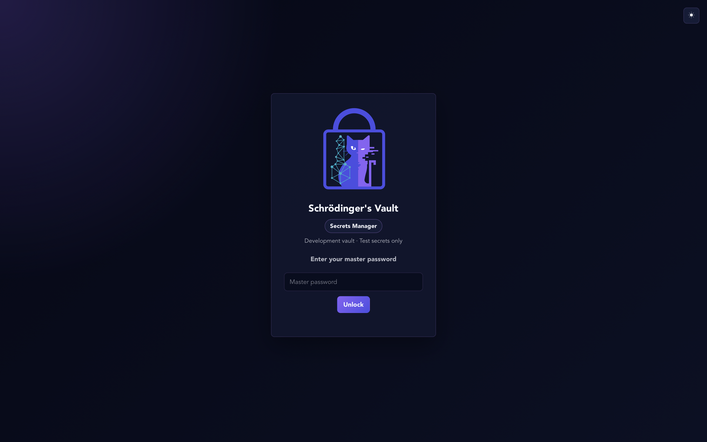
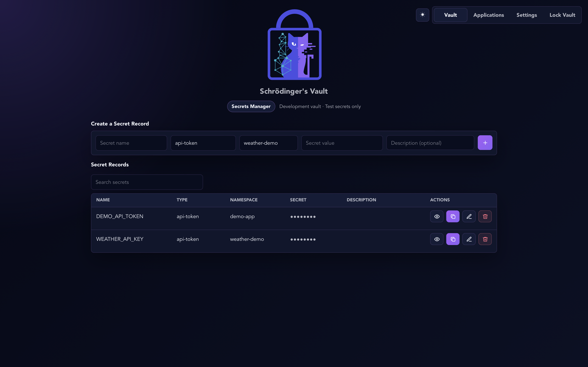

# Getting started on macOS

This guide is for people who have not built an application before. You do not need a weather API key to try the vault. Start with the harmless demonstration secret below.

## Before you begin

- Use a Mac for this guide. The current local application-access workflow is evaluated on macOS.
- Allow time for tool installation and the first build. Downloads and compilation can take several minutes or longer.
- Use a strong, unique master password and keep it safe. There is no email-based password reset or recovery service.
- Do not use production credentials for your first experiment.
- These instructions launch a development build. They have been checked against the project configuration, but are not a fresh-machine installation certification.

**What is Terminal?** It is a macOS app where you type commands. Open Spotlight with **Command + Space**, type **Terminal**, and press **Return**. Copy only the command inside each code block, then press Return. Run commands one at a time. If one fails, stop and read the error before continuing.

## 1. Install the build tools

Building means turning the project's source files into an application your Mac can run. These tools are needed for building; future verified installers should not require users to install them.

1. Install Apple's command-line developer tools. In Terminal, run:

   ```sh
   xcode-select --install
   ```

   Follow Apple's installation prompt and let it finish. If macOS says the tools are already installed, continue.

2. Install an LTS version of Node.js from the [official Node.js download page](https://nodejs.org/en/download). Node.js includes `npm`, which downloads the project's JavaScript dependencies.

3. Install Rust using the instructions on the [official Rust installation page](https://www.rust-lang.org/tools/install). Rust includes `cargo`, which builds the application core. Use the default stable toolchain unless a release explicitly specifies another version.

4. Install CMake and Ninja for the native cryptography build. If you already use [Homebrew](https://brew.sh/), run:

   ```sh
   brew install cmake ninja
   ```

   If Homebrew is not installed, follow its official instructions first. Do not use installation scripts from an untrusted website. The cryptography library also needs a working C/Clang toolchain; the Apple developer tools supply the compiler. If the build reports that `libclang` cannot be found, see the troubleshooting section rather than guessing paths.

5. Close and reopen Terminal, then check the tools one command at a time:

   ```sh
   node --version
   npm --version
   rustc --version
   cargo --version
   cmake --version
   ninja --version
   clang --version
   ```

Each command should print version information. If you see “command not found,” finish installing that tool before continuing.

Sources: [Tauri's macOS prerequisites](https://v2.tauri.app/start/prerequisites/) and [Open Quantum Safe's Rust bindings](https://github.com/open-quantum-safe/liboqs-rust). A clean-machine build must still be verified for the release being distributed.

## 2. Download the source code

1. On [this project's GitHub page](https://github.com/EvolvingCyberOpenSource/SchrodingerVault-SecretManager), select the green **Code** button, then **Download ZIP**. You can also [download the source ZIP directly](https://github.com/EvolvingCyberOpenSource/SchrodingerVault-SecretManager/archive/refs/heads/main.zip). While the repository is private, you must be signed in with an authorized GitHub account.
2. Open the downloaded ZIP in Finder to extract it.
3. Open the extracted project folder, then the folder named **schrodinger-vault**. You should see `package.json`, `package-lock.json`, `src`, and `src-tauri`.
4. In Terminal, type `cd` followed by a space. Do not press Return yet.
5. Drag the **schrodinger-vault** folder from Finder into Terminal. This inserts its location, including any necessary escaping for spaces.
6. Press Return.

`cd` means “change directory.” It tells Terminal which folder to work in. Do not double-click `src/index.html` to run the vault: its security functions require the Rust desktop core.

## 3. Download dependencies and launch

In that Terminal window, run:

```sh
npm ci
```

This installs the JavaScript dependencies recorded in the lockfile. Wait for it to finish. Then run:

```sh
npm run dev
```

The first launch downloads and compiles Rust dependencies. Keep Terminal open. A desktop window should appear when the build finishes. The development app may be named **Schrodinger Secrets Dev**.

If the command stops with an error and no window appears, use [Troubleshooting](#troubleshooting). Do not use `sudo npm` or delete vault files to try to fix a build problem.

## 4. Create or unlock your vault

On first use, the app asks you to create and confirm a master password. Leave the default password-derivation option selected unless you understand the alternative. Select **Create Master Password**.

If a vault already exists, enter its master password and select **Unlock**. Do not reset an existing vault just to follow this guide.



Your master password is for you. Do not give it to a connected application or enter it into an online demo site.

## 5. Save a harmless test secret

In **Vault**, find **Create a Secret Record** and enter:

| Field | Example | What it means |
| --- | --- | --- |
| Secret name | `DEMO_API_TOKEN` | The label used to identify the record |
| Type | `api-token` | A description of the kind of secret |
| Namespace | `demo-app` | The group an approved client may access |
| Secret value | `dummy-token-for-testing-only` | A fake value for learning, not a real credential |
| Description | `My first test secret` | An optional reminder |

Select the purple **+** button. The record should appear in **Secret Records** with its value hidden.


The row actions let you reveal, copy, edit, or delete a record. Use them only with your fake test value while learning. Before taking a screenshot, hide any secret values.

## 6. Lock and unlock again

1. Select **Lock Vault** in the top navigation.
2. Confirm that the unlock screen appears.
3. Enter your master password and unlock again.
4. Confirm that your test record is still listed.

Locking does not delete your saved record. It stops new secret retrieval until you unlock again. The current desktop app also locks after five minutes of user inactivity.

Before ending a development session, lock the vault and close its window. You can then stop the development command with **Control + C** in Terminal. To launch again, return to the same project folder and run `npm run dev`.

## Connect an application

You can use the vault interface without connecting another app. Connecting one requires an integration: it is not enough to install the vault beside an arbitrary website.

The setup has two sides:

1. **In the client application:** generate its private authentication identity. This is separate from both your master password and the API key you want to store.
2. **In the client application:** request registration for one namespace.
3. **In the unlocked vault:** open **Applications** and find the pending request. Check the application name, namespace, and public-key fingerprint against the client's display. A fingerprint is a short representation of its public key, used to check that you are approving the expected identity.
4. Approve only a request you recognize. Save the assigned client ID in the client's configuration.
5. The client authenticates and can list or retrieve records only within its permitted namespace while the vault is unlocked.

**Local endpoint** means the communication address on your own Mac. Copy the value shown in **Applications** into the client's setup when requested. It is not a website URL. Do not copy a path from someone else's screenshot: their macOS username and installation may differ.

For the separate weather demonstration, the record name is `WEATHER_API_KEY` and the namespace is `weather-demo`. The screenshot below shows that naming, with values masked. A real weather key must come from your own provider account. A fake key is enough to learn vault storage, but cannot fetch live weather.



The weather website is a separate project. Commands such as `npm run vault -- init` belong to that client project, not this vault repository. Do not run them here. Developers can start with the [included Rust client and protocol guide](../schrodinger-vault/docs/LOCAL_IPC.md).

### What happens when the vault is locked?

An application cannot retrieve a new secret while the vault is locked. It may still have a copy it retrieved earlier; whether it retains one depends on the client implementation. The weather demonstration requests its secret for each new provider request, so a locked vault prevents those new requests.

### What does Revoke do?

Revocation withdraws that client's permission to authenticate. The current implementation also disconnects existing client connections; other non-revoked clients can reconnect. Revocation cannot erase previously delivered copies or cancel the API key at its provider. If a key is exposed, rotate or revoke it with the provider too.

## Where is my data?

The current macOS development configuration uses:

```text
~/Library/Application Support/com.evolvingcyber.svdev/
```

Here `~` means your own user folder. The app keeps encrypted records and separate device-key material locally. A copy of the database alone is not a complete recoverable backup. Do not delete or move application-data files, upload them to GitHub, or assume you can transfer the vault to another computer. There is no beginner recovery workflow in this prototype.

## Troubleshooting

| What you see | What to do |
| --- | --- |
| `npm: command not found` or `cargo: command not found` | Finish installing Node.js or Rust, then open a new Terminal window. |
| Missing `package.json` or an `ENOENT` error | Check that Terminal is inside `schrodinger-vault`, not the outer repository folder. |
| A long first build | Keep Terminal open. Rust and native dependencies may still be compiling. If a command exits with an error, save the error text. |
| CMake, compiler, or `libclang` error | Check the prerequisite versions and Apple's developer tools. Consult the linked Open Quantum Safe build instructions. Ask for help with the error rather than changing security settings or copying arbitrary library paths. |
| Vault denied a client request | Check that the vault is running and unlocked, the client is approved and not revoked, and the namespace matches exactly. |
| Record exists in the desktop UI but is absent from client listings | For an older development record, open its editor and explicitly save it again to create its integrity binding. Do not bypass verification. |
| Wrong password or unavailable device key | Stop and verify you are opening the intended vault. Do not delete files or reset the vault to recover existing data. |
| Weather provider error | First verify vault authentication and record access. Then check the provider account and key privately. Do not post the key in an issue. |

When asking for help, include your macOS version, the command you ran, and the error message. Remove secrets, passwords, private keys, account details, and unnecessary personal paths first.

## A note about the screenshots

These images show the development app and illustrative records. Secret values are masked. Namespaces and labels must match your own client setup; screenshots are examples, not configuration files. Their original screenshot numbers are intentionally omitted.
